


<a href="https://loonailove.github.io"></a><a href="https://www.linkedin.com/in/daiana-dindere/"></a><a href="mailto:daianagab29@gmail.com"></a>


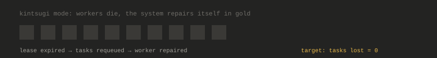

<a href="https://github.com/loonailove/kintsugi-scheduler">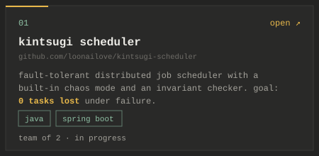</a><a href="https://github.com/lupsalexandra33/container-vuln-scanner">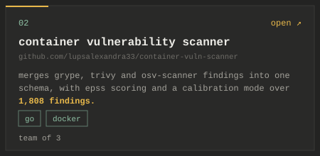</a>
<a href="https://github.com/loonailove/supercapacitor-analyzer">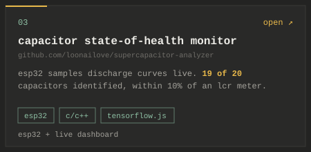</a><a href="https://github.com/AlexToader1/CityPulse">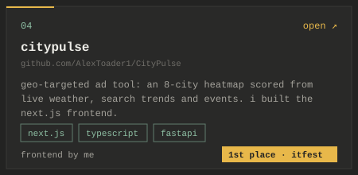</a>

<a href="https://loonailove.github.io">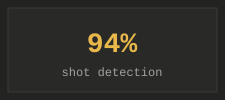</a><a href="https://github.com/loonailove/supercapacitor-analyzer">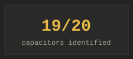</a><a href="https://github.com/lupsalexandra33/container-vuln-scanner">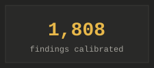</a><a href="https://github.com/AlexToader1/CityPulse">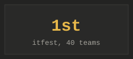</a>

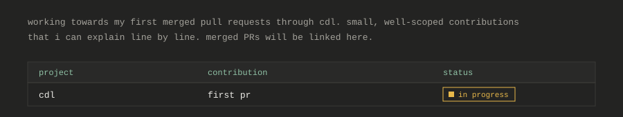



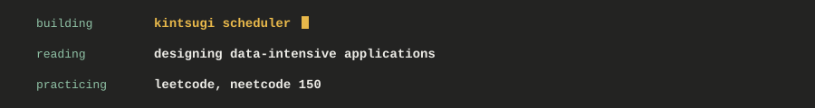

<a href="mailto:daianagab29@gmail.com">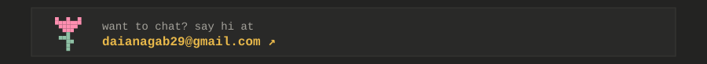</a>

